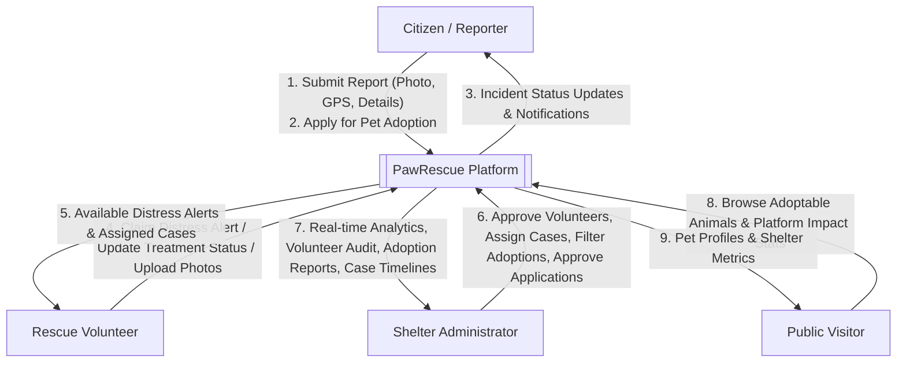
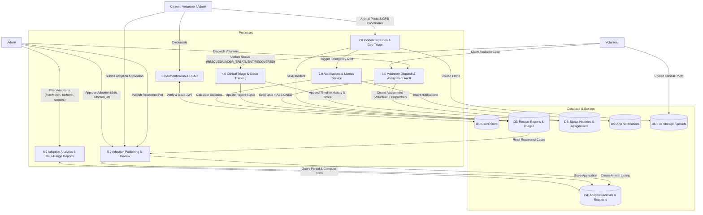
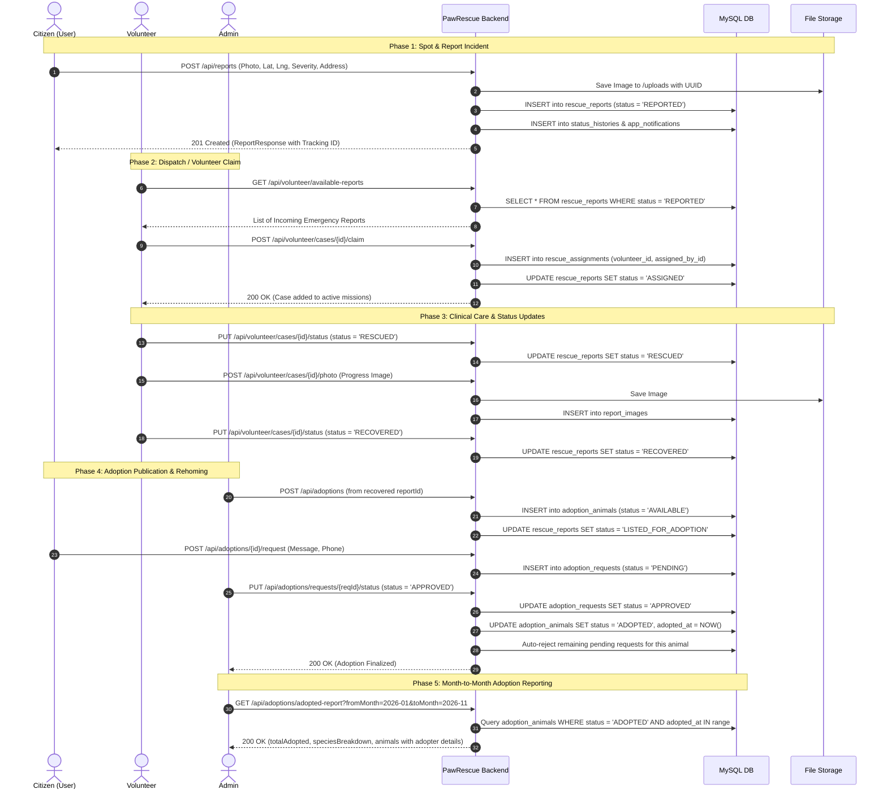
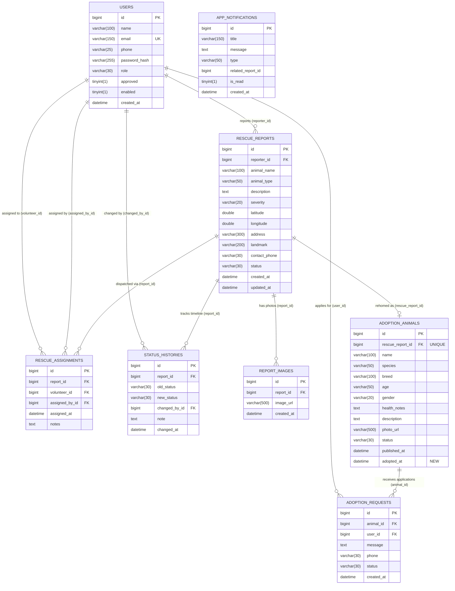

# PawRescue - Role-Based Animal Rescue & Adoption Platform

[](https://spring.io/projects/spring-boot)
[](https://react.dev/)
[](https://www.mysql.com/)
[](https://www.oracle.com/java/)
[](https://spring.io/projects/spring-security)

PawRescue is a production-ready, full-stack, role-based platform designed to coordinate rapid-response animal rescues, field dispatching, clinical treatment logging, volunteer tracking, and public adoption rehoming. It connects citizens in the community, verified rescue volunteers in the field, and shelter administrators into a unified real-time workflow.

---

## Table of Contents
1. [Core Concept & System Overview](#-core-concept--system-overview)
2. [Role-Based Access Control (RBAC)](#-role-based-access-control-rbac)
3. [Key Production Features](#-key-production-features)
   - [Real-Time Rescue Dispatch & Volunteer Tracking](#real-time-rescue-dispatch--volunteer-tracking)
   - [GPS Inspection & Google Maps Route Navigation](#gps-inspection--google-maps-route-navigation)
   - [Clinical Recovery & Veterinary Care Logs](#clinical-recovery--veterinary-care-logs)
   - [Month-to-Month Adoption Filtering & Analytics](#month-to-month-adoption-filtering--analytics)
4. [System Architecture](#-system-architecture)
5. [Data Flow Diagrams (DFD)](#-data-flow-diagrams-dfd)
   - [Level 0: Context Diagram](#level-0-context-diagram)
   - [Level 1: System Process Decomposition](#level-1-system-process-decomposition)
   - [Level 2: Rescue Incident & Adoption Lifecycle](#level-2-rescue-incident--adoption-lifecycle)
6. [Entity Relationship Diagram (ERD) & Database Schema](#-entity-relationship-diagram-erd--database-schema)
   - [Mermaid ERD](#mermaid-erd)
   - [Database Tables & Column Specifications](#database-tables--column-specifications)
7. [Tech Stack & Package Versions](#-tech-stack--package-versions)
8. [Environment Configuration & Secrets](#-environment-configuration--secrets)
9. [Setup & Installation Guide](#-setup--installation-guide)
10. [Pre-Seeded Demo Accounts](#-pre-seeded-demo-accounts)
11. [REST API Documentation](#-rest-api-documentation)
12. [End-to-End Testing Walkthrough](#-end-to-end-testing-walkthrough)

---

## 🐾 Core Concept & System Overview

When a street or wild animal is injured, every minute counts. PawRescue streamlines the rescue pipeline:

1. **Spot & Auto-Locate:** A citizen spots an animal in distress, clicks a photo via camera upload, and the HTML5 Geolocation API auto-captures exact GPS coordinates with OpenStreetMap reverse-geocoding into a street address.
2. **Real-Time Dispatch:** The incident alert immediately propagates to both the Admin Command Center and verified Volunteers via the **Incoming Distress Alerts** dispatch feed.
3. **Acceptance & Field Rescue:** An approved volunteer claims the emergency or an administrator dispatches them. The system tracks **which volunteer went for rescue**, **who assigned them**, and **exact dispatch timestamps**.
4. **GPS Inspection & Routing:** Administrators and field volunteers inspect GPS distress coordinates on interactive Leaflet maps and open 1-click turn-by-turn directions via Google Maps.
5. **Clinical Care & Milestones:** The animal is admitted to veterinary care (`UNDER_TREATMENT`). Caretakers log medical triage notes, surgical interventions, and recovery milestones.
6. **Recovery & Adoption Publication:** Once marked `RECOVERED`, administrators publish the pet to the public adoption gallery with 1-click pre-filled medical records.
7. **Adoption Applications & Approval:** Citizens submit adoption applications with home suitability details. Shelter administrators review applications; upon approval, the pet is marked `ADOPTED` with an exact `adoptedAt` timestamp, and other pending applications are automatically resolved.
8. **Date-Range Adoption Analytics:** Administrators filter adoption figures from month to month (or custom date spans), inspect species breakdowns, and analyze time-to-adoption metrics.

### Incident Lifecycle State Machine
```
REPORTED ───> ASSIGNED ───> RESCUED ───> UNDER_TREATMENT ───> RECOVERED ───> LISTED_FOR_ADOPTION ───> ADOPTED
   │              │             │               │                │
   └──(Cancelled / Not Found)───┴───────────────┴────────────────┘
```

---

## 👥 Role-Based Access Control (RBAC)

The platform enforces strict role-based authorization at both backend API filters (Spring Security method-level annotations) and frontend navigation route guards:

| Role | Access Permissions & Responsibilities |
|---|---|
| **PUBLIC (Visitor)** | Browse landing page, live platform statistics, browse adoptable pets gallery, view detailed pet health records without logging in. |
| **ROLE_USER (Citizen / Adopter)** | Submit new emergency distress reports with camera capture & GPS pin, track live timeline of own reported rescues, submit adoption applications, and track application status. |
| **ROLE_VOLUNTEER** | View unassigned incoming distress calls, accept/claim rescue missions, access assigned cases workspace, navigate to incident locations via Google Maps, transition status (`RESCUED`, `UNDER_TREATMENT`, `RECOVERED`), add medical notes, and upload recovery photos. (New signups require admin approval before dispatch access). |
| **ROLE_ADMIN** | Complete control: Real-time dashboard KPI analytics, emergency report management, volunteer dispatching & tracking (who went for rescue & who assigned them), volunteer approval/disabling, user account management, month-to-month adoption date-range filtering, publishing recovered animals, and approving/rejecting adoption applications. |

---

## ⚡ Key Production Features

### Real-Time Rescue Dispatch & Volunteer Tracking
* **Audit Which Volunteer Went for Rescue:** In both the **Animal Reports & Dispatch** and **Rescue Cases** sections, each case displays:
  * Assigned volunteer name with an ambulance indicator.
  * Direct contact links (`tel:` and email) for on-site communication.
  * **Who Assigned Them:** Name of the shelter administrator or system authority who issued the dispatch (or self-claimed by volunteer).
  * **Dispatch Timestamp:** Formatted date, time, and relative elapsed time (e.g. `2h ago`).
* **Volunteer-Specific Filtering:** Admins can filter all cases/reports handled by any specific volunteer, or quickly view all unassigned reports needing immediate dispatch.
* **1-Click Volunteer Reassignment:** Admins can change or reassign volunteers with custom handling instructions (e.g. "Bring dog crate and muzzle").

### GPS Inspection & Google Maps Route Navigation
* **Pinpoint Accuracy:** Exact latitude and longitude coordinates stored with 6 decimal place precision.
* **Embedded Interactive Map:** Powered by Leaflet and OpenStreetMap tiles.
* **1-Click Google Maps Routing:** Direct external navigation link (`https://www.google.com/maps/dir/?api=1&destination=lat,lng`) opens turn-by-turn driving or walking directions on mobile and desktop.
* Landmark details and reporter callback phone number accessible directly in the inspection modal.

### Clinical Recovery & Veterinary Care Logs
* **Medical Triage Logging:** Admins and volunteers record clinical notes (medication administered, surgery, wound dressing, vet clinic name).
* **Recovery Phase Stepper:** Tracks progression through `REPORTED` $\rightarrow$ `ASSIGNED` $\rightarrow$ `RESCUED` $\rightarrow$ `UNDER_TREATMENT` $\rightarrow$ `RECOVERED` $\rightarrow$ `LISTED_FOR_ADOPTION` $\rightarrow$ `ADOPTED`.
* **Complete Audit Timeline:** Modal stepper displaying every milestone, the timestamp, and who made the change.

### Month-to-Month Adoption Filtering & Analytics
* **Date-Range Filter:** Filter adoptions from month to month (e.g., `2026-01` to `2026-11`) or custom date ranges.
* **Quick Presets:** "This Month", "Last Month", "Last 3 Months", "Year to Date", and "All Time".
* **KPI Metrics & Species Distribution:** Total adoptions count, species breakdown badges (Dogs, Cats, Puppies, etc.), and average days in shelter care.
* **Adopter Profiles:** Detailed table displaying pet photo, species/breed, adopter name, contact phone, email, and origin rescue case ID.

---

## 🏗️ System Architecture

PawRescue is built using a modern 3-tier decoupled architecture:

```
┌─────────────────────────────────────────────────────────────────────────────┐
│                              CLIENT TIER                                    │
│   React 19 SPA (Vite 8) + React Router v7 + Leaflet Maps + Lucide Icons     │
│   Responsive UI (Mobile Touch First + Desktop Dashboard Grid)               │
└──────────────────────────────────────┬──────────────────────────────────────┘
                                       │ HTTPS / JSON & Multipart
                                       ▼
┌─────────────────────────────────────────────────────────────────────────────┐
│                          APPLICATION SERVER TIER                            │
│  Spring Boot 3.4.3 Web Server (Port 8080)                                   │
│  ┌───────────────────────────────────────────────────────────────────────┐  │
│  │ Security Filter Chain: JwtAuthenticationFilter -> SecurityContext     │  │
│  └───────────────────────────────────┬───────────────────────────────────┘  │
│                                      ▼                                      │
│  ┌───────────────────────────────────────────────────────────────────────┐  │
│  │ Controllers: Auth, Reports, Volunteer, Adoption, Admin, Notifications │  │
│  └───────────────────────────────────┬───────────────────────────────────┘  │
│                                      ▼                                      │
│  ┌───────────────────────────────────────────────────────────────────────┐  │
│  │ Service Layer: Business Rules, State Transitions, Image Validation   │  │
│  └───────────────────────────────────┬───────────────────────────────────┘  │
│                                      ▼                                      │
│  ┌───────────────────────────────────────────────────────────────────────┐  │
│  │ Spring Data JPA / Hibernate ORM Layer                                 │  │
│  └───────────────────────────────────┬───────────────────────────────────┘  │
└──────────────────────────────────────┼──────────────────────────────────────┘
                                       │
                    ┌──────────────────┴──────────────────┐
                    ▼                                     ▼
┌──────────────────────────────────────┐┌──────────────────────────────────────┐
│            DATABASE TIER             ││             STORAGE TIER             │
│ MySQL 8.0 Database (animal_rescue)   ││ Local / Cloud File Storage (uploads/)│
│ - 8 Normalized Tables                ││ - MIME Type & Size Validated Images  │
│ - Foreign Keys & Cascade Constraints ││ - UUID Random File Name Hashes       │
└──────────────────────────────────────┘└──────────────────────────────────────┘
```

---

## 🔄 Data Flow Diagrams (DFD)

### Level 0: Context Diagram



---

### Level 1: System Process Decomposition



---

### Level 2: Rescue Incident & Adoption Lifecycle



---

## 🗄️ Entity Relationship Diagram (ERD) & Database Schema

### Mermaid ERD



---

### Database Tables & Column Specifications

#### 1. `users` Table
Stores authentication credentials, role identities, and approval states.

| Column Name | Data Type | Constraints / Nullable | Description |
|---|---|---|---|
| `id` | `BIGINT` | `PRIMARY KEY`, `AUTO_INCREMENT` | Unique identifier for user |
| `name` | `VARCHAR(100)` | `NOT NULL` | Full legal name |
| `email` | `VARCHAR(150)` | `NOT NULL`, `UNIQUE` | User login email address |
| `phone` | `VARCHAR(25)` | `NULL` | Contact phone number |
| `password_hash` | `VARCHAR(255)` | `NOT NULL` | BCrypt encrypted password string |
| `role` | `VARCHAR(30)` | `NOT NULL`, Default: `ROLE_USER` | `ROLE_USER`, `ROLE_VOLUNTEER`, `ROLE_ADMIN` |
| `approved` | `TINYINT(1)` | `NOT NULL`, Default: `1` | `1` for approved; `0` for pending volunteers |
| `enabled` | `TINYINT(1)` | `NOT NULL`, Default: `1` | `1` for active; `0` for disabled accounts |
| `created_at` | `DATETIME` | `NOT NULL` | Account creation timestamp |

#### 2. `rescue_reports` Table
Stores incident reports submitted by citizens or rescue hotline.

| Column Name | Data Type | Constraints / Nullable | Description |
|---|---|---|---|
| `id` | `BIGINT` | `PRIMARY KEY`, `AUTO_INCREMENT` | Unique incident identifier |
| `reporter_id` | `BIGINT` | `NULL`, `FOREIGN KEY (users.id)` | User who submitted report (null if anonymous) |
| `animal_name` | `VARCHAR(100)` | `NULL` | Assigned name or identifier |
| `animal_type` | `VARCHAR(50)` | `NOT NULL` | E.g. Dog, Cat, Bird, Cow |
| `description` | `TEXT` | `NOT NULL` | Description of injuries and scene |
| `severity` | `VARCHAR(20)` | `NOT NULL`, Default: `MEDIUM` | `LOW`, `MEDIUM`, `CRITICAL` |
| `latitude` | `DOUBLE` | `NOT NULL` | GPS latitude coordinates |
| `longitude` | `DOUBLE` | `NOT NULL` | GPS longitude coordinates |
| `address` | `VARCHAR(300)` | `NULL` | Reverse-geocoded or entered address |
| `landmark` | `VARCHAR(200)` | `NULL` | Nearby recognizable landmark |
| `contact_phone` | `VARCHAR(30)` | `NULL` | Spotter's callback phone number |
| `status` | `VARCHAR(30)` | `NOT NULL`, Default: `REPORTED` | Lifecycle status (`REPORTED` ... `ADOPTED`) |
| `created_at` | `DATETIME` | `NOT NULL` | Initial report submission timestamp |
| `updated_at` | `DATETIME` | `NOT NULL` | Last status or detail modification time |

#### 3. `report_images` Table
Stores photographic evidence from citizens and clinical updates from volunteers.

| Column Name | Data Type | Constraints / Nullable | Description |
|---|---|---|---|
| `id` | `BIGINT` | `PRIMARY KEY`, `AUTO_INCREMENT` | Unique image record ID |
| `report_id` | `BIGINT` | `NOT NULL`, `FOREIGN KEY (rescue_reports.id)` | Related incident report |
| `image_url` | `VARCHAR(500)` | `NOT NULL` | Local static path (e.g. `/uploads/uuid.jpg`) |
| `created_at` | `DATETIME` | `NOT NULL` | Upload timestamp |

#### 4. `rescue_assignments` Table
Maps field volunteers to rescue reports and tracks who authorized the dispatch.

| Column Name | Data Type | Constraints / Nullable | Description |
|---|---|---|---|
| `id` | `BIGINT` | `PRIMARY KEY`, `AUTO_INCREMENT` | Unique assignment ID |
| `report_id` | `BIGINT` | `NOT NULL`, `FOREIGN KEY (rescue_reports.id)` | Incident report ID |
| `volunteer_id` | `BIGINT` | `NOT NULL`, `FOREIGN KEY (users.id)` | Dispatched volunteer user ID |
| `assigned_by_id` | `BIGINT` | `NOT NULL`, `FOREIGN KEY (users.id)` | Admin or self-assigning volunteer ID |
| `assigned_at` | `DATETIME` | `NOT NULL` | Time assignment occurred |
| `notes` | `TEXT` | `NULL` | Special dispatch or handling notes |

#### 5. `status_histories` Table
Immutable audit log tracking every state change in an animal's journey.

| Column Name | Data Type | Constraints / Nullable | Description |
|---|---|---|---|
| `id` | `BIGINT` | `PRIMARY KEY`, `AUTO_INCREMENT` | Unique history record ID |
| `report_id` | `BIGINT` | `NOT NULL`, `FOREIGN KEY (rescue_reports.id)` | Incident report ID |
| `old_status` | `VARCHAR(30)` | `NULL` | Previous lifecycle state |
| `new_status` | `VARCHAR(30)` | `NOT NULL` | Transitioned lifecycle state |
| `changed_by_id` | `BIGINT` | `NULL`, `FOREIGN KEY (users.id)` | User who executed the transition |
| `note` | `TEXT` | `NULL` | Clinical or operational note |
| `changed_at` | `DATETIME` | `NOT NULL` | Timestamp of transition |

#### 6. `adoption_animals` Table
Public listings of recovered rescue animals ready for adoption.

| Column Name | Data Type | Constraints / Nullable | Description |
|---|---|---|---|
| `id` | `BIGINT` | `PRIMARY KEY`, `AUTO_INCREMENT` | Unique adoption pet profile ID |
| `rescue_report_id` | `BIGINT` | `NULL`, `UNIQUE`, `FOREIGN KEY (rescue_reports.id)` | Originating rescue case |
| `name` | `VARCHAR(100)` | `NOT NULL` | Pet's name |
| `species` | `VARCHAR(50)` | `NOT NULL` | E.g. Dog, Cat, Rabbit |
| `breed` | `VARCHAR(100)` | `NULL` | Breed / mix |
| `age` | `VARCHAR(50)` | `NULL` | Approximate age |
| `gender` | `VARCHAR(20)` | `NULL` | `Male`, `Female`, `Unknown` |
| `health_notes` | `TEXT` | `NULL` | Vaccination, spay/neuter, recovery notes |
| `description` | `TEXT` | `NULL` | Temperament and behavioral profile |
| `photo_url` | `VARCHAR(500)` | `NULL` | Featured showcase photo |
| `status` | `VARCHAR(30)` | `NOT NULL`, Default: `AVAILABLE` | `AVAILABLE`, `PENDING`, `ADOPTED` |
| `published_at` | `DATETIME` | `NOT NULL` | Publication date |
| `adopted_at` | `DATETIME` | `NULL` | **Timestamp when adoption request was approved** |

#### 7. `adoption_requests` Table
Adoption applications submitted by prospective adopters.

| Column Name | Data Type | Constraints / Nullable | Description |
|---|---|---|---|
| `id` | `BIGINT` | `PRIMARY KEY`, `AUTO_INCREMENT` | Unique application ID |
| `animal_id` | `BIGINT` | `NOT NULL`, `FOREIGN KEY (adoption_animals.id)` | Target pet ID |
| `user_id` | `BIGINT` | `NOT NULL`, `FOREIGN KEY (users.id)` | Applicant user ID |
| `message` | `TEXT` | `NOT NULL` | Living condition & experience details |
| `phone` | `VARCHAR(30)` | `NOT NULL` | Applicant callback telephone |
| `status` | `VARCHAR(30)` | `NOT NULL`, Default: `PENDING` | `PENDING`, `APPROVED`, `REJECTED` |
| `created_at` | `DATETIME` | `NOT NULL` | Submission timestamp |

#### 8. `app_notifications` Table
Real-time operational alerts for system administrators and field teams.

| Column Name | Data Type | Constraints / Nullable | Description |
|---|---|---|---|
| `id` | `BIGINT` | `PRIMARY KEY`, `AUTO_INCREMENT` | Unique notification ID |
| `title` | `VARCHAR(150)` | `NOT NULL` | Alert headline |
| `message` | `TEXT` | `NOT NULL` | Detailed notification body |
| `type` | `VARCHAR(50)` | `NOT NULL`, Default: `INFO` | `RESCUE`, `ASSIGNMENT`, `STATUS_CHANGE`, `ADOPTION` |
| `related_report_id` | `BIGINT` | `NULL` | Associated rescue case ID |
| `is_read` | `TINYINT(1)` | `NOT NULL`, Default: `0` | `0` = Unread, `1` = Read |
| `created_at` | `DATETIME` | `NOT NULL` | Creation timestamp |

---

## 🛠️ Tech Stack & Package Versions

### Backend (Spring Boot)
- **Language / Runtime:** Java 17+ (LTS)
- **Framework:** Spring Boot `3.4.3`
- **Security:** Spring Security 6 with stateless JWT authentication
- **JWT Provider:** `io.jsonwebtoken:jjwt-api:0.12.6`, `jjwt-impl`, `jjwt-jackson`
- **ORM / Persistence:** Spring Data JPA + Hibernate Core
- **Database Driver:** `mysql:mysql-connector-j:8.3.0`
- **Validation:** `jakarta.validation:jakarta.validation-api`
- **Build Tool:** Apache Maven 3.9+ via wrapper (`mvnw`)

### Frontend (React SPA)
- **Core Library:** React `19.0.0` & React DOM `19.0.0`
- **Bundler & Tooling:** Vite `8.3.4`
- **Routing:** React Router DOM `7.2.0`
- **HTTP Client:** Axios `1.7.9` (configured with request & response interceptors)
- **Mapping & Geolocation:** Leaflet `1.9.4` + React-Leaflet `5.0.0` + OpenStreetMap Tile Server
- **Icons:** Lucide React `0.475.0` (production-grade SVG iconography, zero emojis)

---

## ⚙️ Environment Configuration & Secrets

All configuration parameters are defined in `backend/src/main/resources/application.properties` with fallback defaults for local development:

| Property Key | Environment Override | Local Dev Default | Description |
|---|---|---|---|
| `server.port` | `PORT` | `8080` | HTTP port for backend API |
| `spring.datasource.url` | `SPRING_DATASOURCE_URL` | `jdbc:mysql://localhost:3306/animal_rescue?...` | MySQL connection string |
| `spring.datasource.username` | `SPRING_DATASOURCE_USERNAME` | `root` | MySQL user |
| `spring.datasource.password` | `SPRING_DATASOURCE_PASSWORD` | `12345` | MySQL password |
| `spring.jpa.hibernate.ddl-auto` | `DDL_AUTO` | `update` | Hibernate schema sync mode |
| `app.jwt.secret` | `JWT_SECRET` | `404E63526655...` | 256-bit HMAC secret |
| `app.jwt.expiration-ms` | `JWT_EXPIRATION_MS` | `86400000` (24h) | JWT validity window |
| `app.admin.email` | `ADMIN_EMAIL` | `admin@pawrescue.org` | Seeded admin email |
| `app.admin.password` | `ADMIN_PASSWORD` | `Admin@123` | Seeded admin password |
| `app.upload.dir` | `UPLOAD_DIR` | `uploads` | Image upload directory |

---

## 🚀 Setup & Installation Guide

### Step 1: Clone & Configure MySQL
Start MySQL server and run the database initialization query:
```sql
CREATE DATABASE IF NOT EXISTS animal_rescue 
  CHARACTER SET utf8mb4 
  COLLATE utf8mb4_unicode_ci;
```

### Step 2: Build & Start Backend
Open a terminal in `backend/`:
```bash
# Verify Java 17+ is installed
java -version

# Build & Run with Maven Wrapper
.\mvnw.cmd spring-boot:run

# Or run the compiled production JAR:
java -jar target\animal-rescue-backend-0.0.1-SNAPSHOT.jar
```
The backend initializes the database schema, seeds default accounts and sample cases, and starts listening at `http://localhost:8080`.

### Step 3: Install & Start Frontend
Open a separate terminal in `frontend/`:
```bash
# Install NPM dependencies
npm install

# Start Vite Development Server
npm run dev
```
Access the application at `http://localhost:5173` (or `http://localhost:5174`).

---

## 🔑 Pre-Seeded Demo Accounts

The database seeder automatically initializes verified accounts for testing:

| Role | Email Address | Password | Permissions & Role |
|---|---|---|---|
| **Administrator** | `admin@pawrescue.org` | `Admin@123` | Full Administrative Access |
| **Volunteer (Rahul)** | `rahul.volunteer@pawrescue.org` | `Volunteer@123` | Active Field Volunteer |
| **Volunteer (Priya)** | `priya.volunteer@pawrescue.org` | `Volunteer@123` | Active Field Volunteer |
| **Volunteer (Amit)** | `amit.pending@pawrescue.org` | `Volunteer@123` | Pending Approval Volunteer |
| **Citizen (Ananya)** | `ananya.citizen@gmail.com` | `User@123` | Registered Citizen Reporter |
| **Citizen (Vikram)** | `vikram.citizen@gmail.com` | `User@123` | Registered Adopter |

> **Pro Tip:** The Login page features **1-Click Quick Fill** buttons for Admin, Volunteer, and Citizen credentials.

---

## 📡 REST API Documentation

### Authentication (`/api/auth`)
| Method | Endpoint | Access | Description |
|---|---|---|---|
| `POST` | `/api/auth/signup` | Public | Register new User or Volunteer account |
| `POST` | `/api/auth/login` | Public | Authenticate and receive JWT token |
| `GET` | `/api/auth/me` | Authenticated | Retrieve profile for active session |

### Rescue Reports (`/api/reports`)
| Method | Endpoint | Access | Description |
|---|---|---|---|
| `POST` | `/api/reports` | `ROLE_USER`, `ADMIN` | Submit emergency distress report (Multipart / JSON) |
| `GET` | `/api/reports/my` | `ROLE_USER` | Fetch reports submitted by the logged-in citizen |
| `GET` | `/api/reports` | `ROLE_ADMIN` | Filtered & paginated view of all incidents |
| `GET` | `/api/reports/{id}` | Owner/Volunteer/Admin | View incident details, images, assignments, and audit history |
| `PUT` | `/api/reports/{id}/status`| Volunteer/Admin | Update report lifecycle status with clinical note |
| `POST` | `/api/reports/{id}/assign`| `ROLE_ADMIN` | Dispatch/reassign volunteer with handling notes |
| `POST` | `/api/reports/{id}/image` | Volunteer/Admin | Upload additional progress or clinical photo |
| `GET` | `/api/reports/statistics` | Public | Aggregate rescue & impact metrics |

### Volunteer Dispatch (`/api/volunteer`)
| Method | Endpoint | Access | Description |
|---|---|---|---|
| `GET` | `/api/volunteer/available-reports` | `ROLE_VOLUNTEER`, `ADMIN` | Live feed of unassigned emergency reports |
| `POST` | `/api/volunteer/cases/{id}/claim` | `ROLE_VOLUNTEER`, `ADMIN` | Claim distress alert & self-assign rescue |
| `GET` | `/api/volunteer/cases` | `ROLE_VOLUNTEER`, `ADMIN` | List of cases assigned to logged-in volunteer |
| `PUT` | `/api/volunteer/cases/{id}/status`| Assigned Volunteer | Advance clinical state (`RESCUED`, `UNDER_TREATMENT`, `RECOVERED`) |
| `POST` | `/api/volunteer/cases/{id}/photo` | Assigned Volunteer | Attach clinical progress photograph |

### Adoption Management (`/api/adoptions`)
| Method | Endpoint | Access | Description |
|---|---|---|---|
| `GET` | `/api/adoptions` | Public | Search and browse available adoptable pets |
| `GET` | `/api/adoptions/{id}` | Public | Get full pet profile and medical background |
| `POST` | `/api/adoptions` | `ROLE_ADMIN` | Publish animal profile (or link recovered report) |
| `PUT` | `/api/adoptions/{id}` | `ROLE_ADMIN` | Update pet profile details |
| `DELETE` | `/api/adoptions/{id}` | `ROLE_ADMIN` | Remove pet from adoption catalog |
| `POST` | `/api/adoptions/{id}/request`| `ROLE_USER` | Submit adoption application |
| `GET` | `/api/adoptions/my-requests`| `ROLE_USER` | View personal adoption requests |
| `GET` | `/api/adoptions/requests` | `ROLE_ADMIN` | Review all incoming adoption applications |
| `PUT` | `/api/adoptions/requests/{id}/status`| `ROLE_ADMIN`| Approve or reject adoption application (sets `adopted_at`) |
| `GET` | `/api/adoptions/adopted-report` | `ROLE_ADMIN` | **Filter adoptions by month/date range (`fromMonth`, `toMonth`, `species`), returning total counts, species breakdown, and adopter profiles** |

### Administration & Metrics (`/api/admin`)
| Method | Endpoint | Access | Description |
|---|---|---|---|
| `GET` | `/api/admin/stats` | `ROLE_ADMIN` | KPI counts and weekly intake graph series |
| `GET` | `/api/admin/users` | `ROLE_ADMIN` | List all registered user accounts |
| `GET` | `/api/admin/volunteers` | `ROLE_ADMIN` | List all volunteers with approval status |
| `PUT` | `/api/admin/volunteers/{id}/approve` | `ROLE_ADMIN` | Approve pending volunteer registration |
| `PUT` | `/api/admin/users/{id}/disable` | `ROLE_ADMIN` | Enable or disable user access |
| `GET` | `/api/admin/recovered-reports` | `ROLE_ADMIN` | List recovered cases ready for adoption |

---

## 🧪 End-to-End Testing Walkthrough

Follow this step-by-step verification checklist to test the full lifecycle:

```
[1. Report Animal] ──> [2. Dispatch Volunteer] ──> [3. Field Rescue & Care] ──> [4. Publish & Adopt] ──> [5. Adoption Analytics]
     (Citizen)                 (Admin)                     (Volunteer)                   (Adopter/Admin)               (Admin)
```

1. **Citizen Reports Animal:**
   - Log in as citizen (`ananya.citizen@gmail.com` / `User@123`).
   - Click **🚨 Report Animal** in the top navigation.
   - Notice device GPS auto-detection and reverse-geocoded address.
   - Attach a photo, select **Severity (Critical)**, describe injuries, and click **Dispatch Animal Rescue Report**.
   - Case is saved in state `REPORTED`.
2. **Volunteer Claims or Admin Dispatches:**
   - **Option A (Admin Dispatch):** Log in as admin (`admin@pawrescue.org` / `Admin@123`). In **Rescue Cases** or **Animal Reports & Dispatch**, find the report, click **Dispatch Volunteer**, select `Rahul Sharma`, and enter notes.
   - **Option B (Volunteer Self-Claim):** Log in as volunteer (`rahul.volunteer@pawrescue.org` / `Volunteer@123`), navigate to **Incoming Distress Alerts**, and click **Accept & Start Rescue**.
   - The assignment record is stored with `volunteer_id`, `assigned_by_id`, and `assigned_at`.
3. **Inspect GPS Location & Google Maps Route:**
   - In **Rescue Cases**, click **Inspect GPS** &rarr; view the Leaflet pinpoint map.
   - Click **Open in Google Maps Directions** &rarr; Google Maps opens with the destination coordinates.
4. **Clinical Care & Treatment:**
   - As volunteer, click **Mark Animal Rescued** &rarr; state changes to `RESCUED`.
   - Click **Place Under Treatment** and upload a progress photo &rarr; state changes to `UNDER_TREATMENT`.
   - As admin or volunteer, click **Log Clinical Note** to record medical care updates.
   - Click **Mark Fully Recovered** &rarr; state changes to `RECOVERED`.
5. **Admin Publishes Pet for Adoption:**
   - In Admin Center, click **+ Publish Pet for Adoption**.
   - Select the recovered case from the dropdown. The form auto-populates with the animal's name, medical history, and photo.
   - Click **Publish to Gallery**. Report status transitions to `LISTED_FOR_ADOPTION`.
6. **Adoption Application & Approval:**
   - Log in as citizen adopter (`vikram.citizen@gmail.com` / `User@123`).
   - Navigate to **Adopt a Pet** (`/adoptions`) and select the pet.
   - Click **♡ Apply to Adopt**, enter home environment details, and submit.
   - Switch back to Admin Center &rarr; **Adoptions** tab &rarr; **Adoption Applications**.
   - Click **Approve**. The pet status transitions to `ADOPTED`, `adopted_at` is stamped, and conflicting applications are automatically resolved.
7. **Month-to-Month Adoption Filter & Analytics:**
   - In Admin Center &rarr; **Adoptions** tab &rarr; **Monthly Adoptions Filter & Stats**.
   - Select **From Month** (e.g. `2026-01`) and **To Month** (e.g. `2026-11`), or click presets like **"Year to Date"** or **"This Month"**.
   - Review total adoptions count, species breakdown badges, and the detailed table showing pet details, adopter names, contact info, and days in shelter care.

---

## 📄 License
This project is licensed under the MIT License - open source for animal welfare organizations worldwide.
